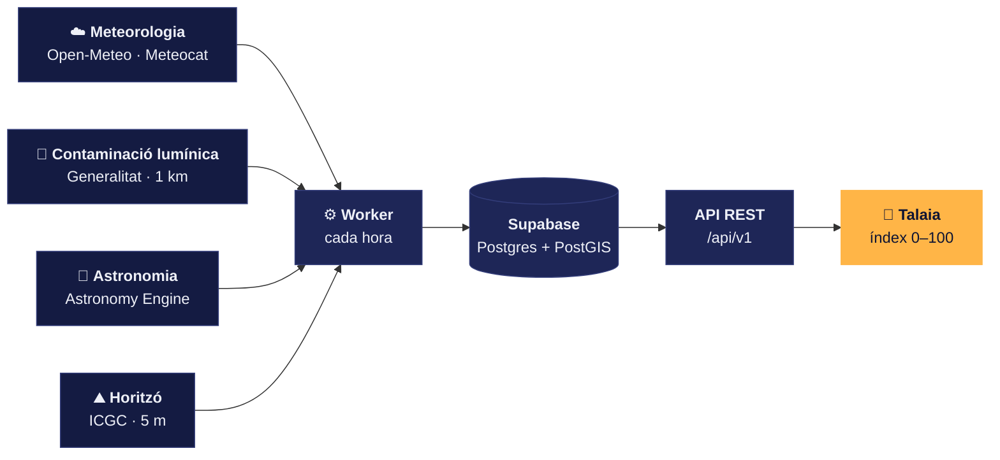
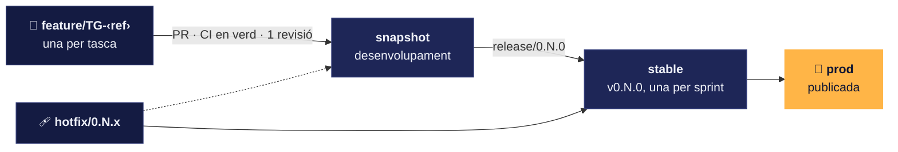

<p align="center">
  
</p>

<h3 align="center">On i quan mirar el cel a Catalunya.</h3>

<p align="center">
  Talaia et diu quin és el millor lloc i el millor moment per veure una posta de sol, la Lluna,<br>
  una pluja d'estels o una constel·lació, amb un <b>índex de visibilitat de 0 a 100</b>.
</p>

<p align="center">
  <a href="https://github.com/pes2627q1-22-gei-upc/talaia/actions/workflows/ci.yml"></a>
  <a href="https://sonarcloud.io/summary/new_code?id=pes2627q1-22-gei-upc_talaia&branch=snapshot"></a>
  
  
  
</p>

<p align="center">
  <a href="docs/onboarding.md"><b>Comença aquí</b></a> ·
  <a href="docs/arquitectura.md">Arquitectura</a> ·
  <a href="docs/decisions/README.md">Decisions</a> ·
  <a href="docs/sprint-1.md">Sprint 1</a> ·
  <a href="https://tree.taiga.io/project/mohamed-dari-pes_22_c_talaia">Taiga</a>
</p>

<br>

## ✦ Què fa

- 🗺️ **Mapa nocturn en 3D** de Catalunya amb els punts d'observació, sobre el relleu i les tessel·les de l'ICGC.
- 🔭 **Índex de visibilitat** per a cada punt i cada hora: núvols, contaminació lumínica, la Lluna i l'horitzó, en un sol número.
- ✨ **Recomanacions**: on anar aquesta nit, i per què, amb el desglossament de l'índex.
- 🌠 **Calendari de fenòmens**: pluges d'estels, eclipsis, fases de la Lluna i conjuncions, amb consells per observar-los des d'aquí.

## ✦ Com es calcula l'índex

Un worker recalcula l'índex de tots els punts **cada hora** i el desa. L'app el demana a l'API ja fet, sense esperar cap càlcul.



## ✦ Posada en marxa

Necessites **Git**, **Node 22** (amb nvm, ja hi ha `.nvmrc`) i **Expo Go** al mòbil. La [guia d'onboarding](docs/onboarding.md) ho explica pas a pas per a macOS, Windows i Linux.

```bash
nvm use && npm install          # instal·la tots els workspaces i activa els hooks de Git
npm run lint && npm run typecheck && npm test
npm run api                     # API a http://localhost:3000/api/v1/docs
npm run mobile                  # app: escaneja el QR amb Expo Go
```

> [!IMPORTANT]
> Els secrets van en dos fitxers que **no es pugen mai** (el repositori és públic): `.env` a l'arrel (API, worker i base de dades) i `apps/mobile/.env` (app). Copia els `.env.example` i demana els valors als administradors per un canal segur.

## ✦ Què hi ha ja

| | Peça | On |
|:-:|---|---|
| 📱 | App amb Expo Go: MVVM, i18n, design system, mapa nocturn 3D i pantalla d'accés | [`apps/mobile`](apps/mobile) |
| 🔌 | API REST amb errors uniformes i documentació OpenAPI a `/api/v1/docs` | [`services/api`](services/api) |
| ⚙️ | Worker: previsió d'Open-Meteo per punt, amb núvols per capes, humitat, visibilitat, temperatura i vent | [`services/worker`](services/worker) |
| 🗄️ | Base de dades: 32 punts d'observació i el calendari astronòmic fins al 2027, amb PostGIS | [`supabase`](supabase) · [`packages/db`](packages/db) |
| 🧩 | Tipus de domini compartits per l'app, l'API i el worker | [`packages/shared`](packages/shared) |
| ✅ | CI a cada PR: lint, typecheck, tests i SonarCloud | [`docs/ci.md`](docs/ci.md) |

El que ve ara, tasca a tasca: [Sprint 1](docs/sprint-1.md) i [Taiga](https://tree.taiga.io/project/mohamed-dari-pes_22_c_talaia).

## ✦ Stack

| Capa | Tecnologia |
|---|---|
| App mòbil | React Native + TypeScript amb **Expo** · Expo Router · Reanimated · TanStack Query |
| Mapa | **MapLibre GL JS** amb les tessel·les vectorials i el relleu 3D de l'**ICGC** |
| API | **Node.js + Express**, REST a `/api/v1`, OpenAPI generat amb zod |
| Worker | Node.js, recàlcul horari de l'índex |
| Dades | **Supabase**: Postgres + **PostGIS**, Auth i Storage · accés amb **Kysely** |
| Qualitat | ESLint · Prettier · Jest · GitHub Actions · SonarCloud |
| Infraestructura | VM Ubuntu amb Docker Compose (API, worker i Nginx) |

Per què cada peça i què es va descartar: [arquitectura](docs/arquitectura.md) i [decisions (ADR)](docs/decisions/README.md).

<details>
<summary><b>Estructura del monorepo</b></summary>

```
talaia/
├── apps/
│   ├── mobile/        App React Native (Expo), MVVM
│   └── admin/         Web d'administració (React)
├── services/
│   ├── api/           API REST Express (/api/v1, OpenAPI)
│   └── worker/        Recàlcul horari de l'índex de visibilitat
├── packages/
│   ├── shared/        Tipus de domini compartits
│   └── db/            Kysely, tipus generats i helpers de PostGIS
├── supabase/          Migracions i seeds
├── data/              Dades obertes i scripts de preprocés
└── docs/              Producte, arquitectura, decisions, sprint i guies
```

</details>

## ✦ Com treballem

**Gitflow** amb els noms de l'assignatura, i tot entra per pull request amb la CI en verd i una revisió aprovada.



- **`snapshot`** és la branca de desenvolupament; **`stable`** té una versió etiquetada per sprint; **`prod`** és la publicada.
- **Commits** en [Conventional Commits](https://www.conventionalcommits.org/en/v1.0.0/), amb el peu `Refs: TG-<ref>` que els lliga a Taiga:

  ```
  feat(api): afegeix GET /punts amb filtre per bbox

  Refs: TG-88
  ```

Tot el detall: [flux de Git](docs/git-workflow.md) i [com contribuir](CONTRIBUTING.md).

## ✦ Documentació

<table>
  <tr>
    <td width="33%">🚀 <a href="docs/onboarding.md"><b>Onboarding</b></a><br><sub>Entorn local i flux d'una tasca</sub></td>
    <td width="33%">🎯 <a href="docs/producte.md"><b>Producte</b></a><br><sub>Abast, MVP i el que no farem</sub></td>
    <td width="33%">🏛️ <a href="docs/arquitectura.md"><b>Arquitectura</b></a><br><sub>Peces i per què</sub></td>
  </tr>
  <tr>
    <td width="33%">📜 <a href="docs/decisions/README.md"><b>Decisions (ADR)</b></a><br><sub>I les <a href="docs/decisions/pendents.md">pendents</a></sub></td>
    <td width="33%">🏃 <a href="docs/sprint-1.md"><b>Sprint 1</b></a><br><sub>Tasques, dates i dependències</sub></td>
    <td width="33%">📋 <a href="docs/backlog.md"><b>Backlog</b></a><br><sub>Històries d'usuari</sub></td>
  </tr>
  <tr>
    <td width="33%">🎨 <a href="docs/design-system.md"><b>Design system</b></a><br><sub>Tokens, moviment i il·lustracions</sub></td>
    <td width="33%">🌿 <a href="docs/git-workflow.md"><b>Flux de Git</b></a><br><sub>Branques, commits i PR</sub></td>
    <td width="33%">🤝 <a href="docs/serveis-externs.md"><b>Serveis entre equips</b></a><br><sub>Aprop i Mobilicat</sub></td>
  </tr>
</table>

Per a agents: [`CLAUDE.md`](CLAUDE.md).

## ✦ Equip

<table align="center">
  <tr>
    <td align="center" width="140"><a href="https://github.com/Jsolee"><br><b>Joan Solé</b></a><br><sub>Sprint master S1 · app</sub></td>
    <td align="center" width="140"><a href="https://github.com/vinyetam"><br><b>Vinyet Amorós</b></a><br><sub>Mapa i CI</sub></td>
    <td align="center" width="140"><a href="https://github.com/martinamaldox"><br><b>Martina Maldonado</b></a><br><sub>Supabase i autenticació</sub></td>
    <td align="center" width="140"><a href="https://github.com/mohamed-dari"><br><b>Mohamed Dari</b></a><br><sub>Punts i desplegament</sub></td>
    <td align="center" width="140"><a href="https://github.com/HugoNienhausen"><br><b>Hugo Nienhausen</b></a><br><sub>Índex de visibilitat</sub></td>
    <td align="center" width="140"><a href="https://github.com/victorlancastle"><br><b>Victor Lancastle</b></a><br><sub>Calendari de fenòmens</sub></td>
  </tr>
</table>

<br>

<p align="center">
  <sub>Projecte d'Enginyeria del Software (PES) · FIB-UPC · 2026-27 Q1 · grup 22 · equip C</sub><br>
  <sub>Lliurables de l'assignatura al Google Drive de l'equip (<code>PES_22_C_TALAIA</code>)</sub>
</p>
